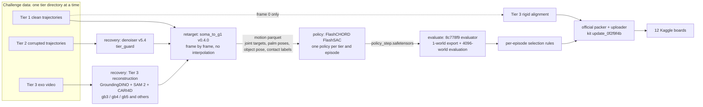

# V2D Challenge Track 2 Engineering Handbook (as of the 2026-11-04 leaderboard freeze)

Maniphys Lab · `main` of the personal repository `Rongxuan-Zhou/v2d-track2-research` (the `track2/p1-training` line plus the post-freeze cleanup, tag `archive-2026-11-05`) · all times are Denver time (MST from 11/01); training-host logs use Beijing time (MST + 15 h)

This handbook collects the engineering record of the Maniphys Lab entry to Track 2 of the NVIDIA Video to Data (V2D) Challenge: the challenge constraints, the system architecture, the method and implementation of each stage, the results, the infrastructure, where the data now lives, the failures we hit and the open problems. It is written for whoever continues research on this data and code. The primary sources are the records cited in each section; this document only summarizes and indexes them. Paths are relative to the code repository root.

Chinese version: `docs/engineering/v2d-track2-engineering-handbook.zh.md`, with the same content.

---

## Contents

1. Project summary
2. Challenge rules that constrain the design
3. System architecture
4. Stages: method and implementation
5. Results
6. Infrastructure and operations
7. Data and artifacts
8. Lessons learned
9. Open problems and research directions
10. Record index
11. Appendix: naming and glossary

---

## 1. Project summary

**Task.** Track 2 (Robotic Grounding) gives 30 human-object interaction episodes. For each episode, the entrant trains a policy for the fixed Unitree G1 + Dex3 robot in the official FlashCHORD simulator, so that the simulated object follows the reference trajectory. The same episodes come in three input tiers, scored separately:

| Tier | Input | Our approach |
|---|---|---|
| Tier 1 | Clean multi-view human and object trajectories | Retarget and train directly |
| Tier 2 | The same trajectories with synthetic corruption (jitter, dropped frames, contact errors) | Denoise with our v5.4 denoiser, then train |
| Tier 3 | Only the exocentric monocular video `observation.images.exo_camera` | Reconstruct human and object motion from the video (CARI4D-based versions), then train |

**Final submissions** (one file per tier, the same file on all four boards; Section 5):

| Tier | File | Code commit | ADD-AUC | SP-SR | MP-SR | MPPE (cm) |
|---|---|---|---|---|---|---|
| Tier 1 | `t1x1102` | `b59f6a6c` | 0.63535 | 0.86666 | 0.70000 | 8.46753 |
| Tier 2 | `b1014` | `c4f248dc` | 0.50890 | 0.73333 | 0.53333 | 15.32195 |
| Tier 3 | `t3m1029a` | `2175e83e` | 0.28173 | 0.46666 | 0.10000 | 36.60061 |

These are public leaderboard scores. Scores of different tiers are not comparable (`docs/report/v2d-track2-technical-report.md`, Section 6).

**Standing at the freeze** (snapshot 11/04 20:10 MST, `results/board/diff_1104_2010.txt`): first place on none of the 12 boards. With the 12 board ranks summed (reading B), the rank sum is 93 under the Kaggle tie rule and 94 under the site tie rule, 7th in both. With the ranks first averaged per tier (reading A), the sum is 28, 6th, tied with one team. The organizers announce results at the CoRL 2026 tutorial on 11/12.

**Timeline (main events):**

| Date | Event |
|---|---|
| 09/23 | Repository created; scope set to the three Track 2 tiers |
| 09/25–09/28 | ADR-00001/2/3 (training stack, tier isolation, stage handoff); 60 retargeted references; Day 1 and Day 2 training chains |
| 10/01–10/12 | Training-host disk pressure; five checkpoint batches archived to HF `v2d-track2-archive`, then deleted locally |
| 10/04 | Tier 2 denoiser plan (v5.x series, clean-room parameters) |
| 10/13–10/14 | First Tier 1 and Tier 2 submissions; Tier 2 `b1013`, `b1014` |
| 10/15–10/18 | Tier 3 probe, intrinsics A/B, `kfix1017`, `gb1018e22`; Tier 1 `t1x1018` |
| 10/19 | Board strategy: submit only with a commanding lead (`agent-doc/strategy-2026-10-19.md`) |
| 10/21 | We take over the Tier 3 reconstruction; the official FAQ allows Tier 1 frame 0 for Tier 3 alignment |
| 10/26 | Tier 3 `t3m1022aa` (frame-0 alignment only) |
| 10/29 | Tier 3 `t3m1029a` (seven episode replacements; first on Tier 3 SP-SR for a time) |
| 11/01–11/02 | Tier 1 `t1x1101`, `t1x1102`; Tier 2 `t2a1102` (AUC board only) |
| 11/03 | Tier 3 `t3m1103a`, Tier 2 `t2a1103` (both AUC only); l40n handed over to another team member |
| 11/04 | Tier 3 `t3m1104c` (AUC only); freeze at 15:00 MST; team renamed Maniphys Lab; one Final Submission per tier; container and technical report on HF; organizer form submitted |
| 11/04 evening | All data organized and uploaded to HF (Section 7) |

---

## 2. Challenge rules that constrain the design

Original wording and sources: `agent-doc/track2-challenge-survey.md` and `results/ops/challenge_faq_1017.txt`. A violation of any of the following makes a submission invalid or its score meaningless.

1. **Tier isolation.** The Tier 2 and Tier 3 pipelines must not read the clean Tier 1 trajectories. The one exception comes from the official FAQ (October 2026): "Using the first frame of Tier 1 data to compute alignment is fine, provided the Tier 1 caption isn't used in Tier 3 otherwise." We read only Tier 1 frame 0 to compute the Tier 3 rigid alignment (Section 4.3). For Tier 3 ep12 and ep27 we picked, between two symmetric branches, the branch that agrees with the frame-0 anchor and retrained on it, so frame-0 information also entered the training reference of these two episodes. Section 5 of the technical report states this.
2. **One tier directory at a time as the dataset root.** Episodes and global frame indices are aligned across tiers for frame-by-frame comparison, not for data sharing.
3. **The monocular input is `observation.images.exo_camera`**, byte-identical across tiers. Object meshes and the ground plane are also byte-identical across tiers.
4. **Fixed embodiment and simulator.** G1 + Dex3 and the official FlashCHORD; no changes to the robot model or the simulator.
5. **Scoring.** Four metrics (ADD-AUC, SP-SR, MP-SR, MPPE), four Kaggle boards per tier, 12 boards in total. The Track 2 standing is the sum of metric ranks, lowest first. The organizers did not state how the tiers combine, so we compute reading A (average per tier, then sum) and reading B (sum of all 12 ranks). Ties go to the earliest submission on Kaggle and alphabetically on the challenge site.
6. **Submission limits.** Five per week per board, unlimited in the last three days before the freeze; the board reflects a submission within 24 hours. Kaggle shows each team's best submission per board. Uploading a file with an unchanged score moves our submission date and loses ties under the earliest-first rule (Section 8).
7. **Final Submission.** Up to two per board; the organizer form requires the same single submission on all four boards of a tier. We selected one per tier (Section 5).
8. **Award eligibility.** A valid final submission, an agreed code release under a research license, and a technical report; the organizers also require a docker container that reproduces the counted scores (the kit's `CONTAINER_SUBMISSION.md`).

---

## 3. System architecture

### 3.1 Data flow

The four stages exchange only files. A downstream stage reads the files that the upstream stage wrote and does not import its code. The reason is interpreter versions: Isaac Lab and FlashCHORD each pin their own Python and dependencies, and the non-Isaac packages use uv (ADR-00003).



### 3.2 Repository layout

| Directory | Contents |
|---|---|
| `libs/v2d_infra/` | Shared layer: `paths.py` (tiers and directory layout), `soma_fk.py` (the single SOMA forward-kinematics entry point, with a disk cache), `add_metrics.py` (local ADD-AUC), `tier_guard.py` (tier-isolation guard) |
| `stages/recovery/` | Tier 2 denoising (`export_tier2.py` v5.4, `cleanroom_params.py`, `t2core.py`, `nopen.py` and others); Tier 3 takeover, run and check scripts (`t3r_*`, `t3_*`, `t3fx_*`, `kfix/`); many analysis scripts |
| `stages/retarget/` | Wrappers around the official retargeter (`challenge_to_soma.py`, `soma_flex.py`, `run_soma_to_g1.py`), reference checks (`ref_*.py`, `check_support_alignment.py`), contact relabeling (`contact_relabel.py`, used by `c10`) |
| `stages/policy/` | Training entry `fc_run.sh`, training chain `day2_train_chain.sh`, chain arming and relays (`arm_*.sh`, `arm_after.sh`, `relay_when_armed.sh`), configuration checks (`precheck_expect.sh`, `assert_cfg.py`, `fc_config_check.sh`), queues (`queues/`), `r3o` gates |
| `stages/evaluate/` | Export chain `export_chain.sh`, per-episode selection `select_t1.py`/`select_t2.py`, Tier 3 frame references and alignment (`make_frame_refs_t3.py`, `align_frefs_t3.py` and others), packing `pack_tier.sh`, board comparison `board_diff.py`, diagnostics |
| `scripts/dev/` | `remote` (rsync, then run on a training host), `record` (output with provenance), `pull-results`/`pull-runs` (copy results back), `relay-run` (move checkpoints between hosts through the Mac), `incontainer`/`in-flash-chord` (one-shot containers) |
| `tools/` | Operations: HF archive and transfer (`hf_archive*.py`, `hf_transfer.py`, `hf_research_*`), board watch `board_watch.sh`, remote status scripts `*_remote.sh`, `name_leak_check.sh` |
| `deploy/` | Host setup (`ml40/`, `l40n/`) and the submission container (`submission_container/`) |
| `third_party/` | Official toolkit (`nvidia-isaac/video_to_data` v0.4.0) and kit versions, unmodified |
| `docs/` | ADRs, contracts, technical report, SOP site, HF READMEs |
| `agent-doc/` | Surveys, plans, reviews and experiment notes (more than one hundred files); not a source of truth |
| `results/` | Text output of every experiment and check, with provenance; in git |
| `runs/`, `data/` | Training artifacts and datasets; not in git |

### 3.3 Runtime environment

| Host | Hardware | Role | Path |
|---|---|---|---|
| Mac | n/a | Code and documents, board watch, Kaggle uploads, pack dry runs | repository working tree |
| mf4090 | 1× RTX 4090 24 GB, 22 cores | Training and evaluation (`cap4m`) | `/home/rxzhou/v2d/maniphys_lab_v2d_challenge` |
| ml40 | 1× L40S 48 GB | Training and evaluation (`cap10m`), Tier 3 reconstruction, container build | `/lab_data/rxzhou/v2d/` (docker and containerd also on `/lab_data`) |
| l40n | GPU host (10 M buffer runs) | Extra training host from 11/02 (Tier 2 `r3o` runs); handed to another team member on 11/03 | `/home/ubuntu/v2d/` |
| CPU host | 4 cores, 15 GB | After the freeze, mounts the ml40 data disk at `/lab_data`; used only for the archive upload | `/lab_data/rxzhou/v2d/` |

Images: `flash_chord:latest` (22 GB; FlashCHORD with Newton, Warp and JAX; all training and evaluation), `robotic-grounding:latest` (Isaac Lab 2.3.2 with the official toolkit; retargeting), and the submission container `maniphys-lab-v2d-submission:final`, built on `flash_chord:latest`. Containers are one-shot (`--rm`) with the repository mounted at `/repo`.

---

## 4. Stages: method and implementation

### 4.1 Retargeting

- The official `soma_to_g1` retargeter (v0.4.0) maps human motion to the G1 + Dex3. The repository holds only thin wrappers, and the official source is unmodified (`stages/retarget/soma_flex.py`, `run_soma_to_g1.py`).
- Retargeting runs frame by frame without interpolation. The object trajectory is used only for the contact labels.
- The output is one reference per episode (robot joint targets, palm poses, object pose and contact labels), stored as a motion parquet (`runs/motion/<tier version>/…/data.parquet`).
- Reference checks: `ref_penetration.py`, `ref_foot_slide.py`, `ref_hand_object_slip.py`, `ref_object_turns.py` and others.
- `c10` (Tier 1 only) starts the hand contact windows of the reference 10 frames earlier and fills gaps of up to 15 frames (`contact_relabel.py`; plans `agent-doc/plan-t1-contact-anticipation-2026-10-16.md`, `plan-c10-extend-2026-10-16.md`).

### 4.2 Tier 2 denoising (v5.4)

The denoiser works on the object trajectory of the Tier 2 input (`stages/recovery/export_tier2.py`; plan `agent-doc/plan-tier2-denoise-2026-10-04.md`):

1. Frames where the object is not visible carry the last valid pose.
2. Static segments are held on a support surface (three degrees of freedom).
3. Motion segments are bridged with Brownian-bridge interpolation.
4. Flips and height are corrected.
5. Ground penetration is removed by the smallest rotation about the object origin (`nopen.py`).
6. The result is smoothed in time.

All thresholds and the rest criterion of v5.4 come from Tier 2 data only (clean-room parameters `cleanroom_params.json`, `cleanroom_params.py`). The human motion of the Tier 2 input goes to retargeting unchanged; its root drift is not corrected.

**Tier isolation in code** (ADR-00002): the denoiser and every Tier 2 analysis script call `tier_guard.forbid_tier1()` at start-up. After the call, any read under the Tier 1 directory raises an error, and `libs/v2d_infra/test_tier_guard.py` shows that cross-tier reads are refused.

### 4.3 Tier 3 reconstruction

Another team member ran the reconstruction on ml40 until 10/21; from 10/21 we owned it (`agent-doc/plan-t3takeover-v3-2026-10-21.md`). We copied her pipeline into our own directories and ran it with her directories read-only: `stages/recovery/t3r_run.sh` uses unshare, mount and setpriv to enforce this at the system level. We never wrote into her directories or stopped her processes.

**Pipeline.** Grounding DINO and SAM 2 segment the person and the object; CARI4D (MoGe-2 depth, FoundationPose object tracking, contact refinement) and the SOMA body model reconstruct them. Object meshes and the ground plane are the released files. The world frame is our own estimate: the main camera is the world camera, plus a ground correction and a scale fit.

**Versions** (technical report, Section 5):

| Version | What it adds |
|---|---|
| `hm` | The first full CARI4D reconstruction (`best_hm`), before the intrinsics calibration of `gb3` |
| `v2` | An earlier reconstruction, used for ep29 only |
| `gb3` | Calibrated intrinsics (focal 866.3 px, principal point 701.8, 531.1 px), ground correction, depth correction `dr2s` and a dynamics pass `dyn7` (locks untouched static segments, removes pose jumps) |
| `gb4` | gb3 with the object refit by a Kabsch fit to the mapped surface and the human re-solved with the SOMA pose inversion |
| `gb5` | gb4 with object poses re-selected among FoundationPose candidates for temporal consistency on 13 episodes; ep15 and ep27 also get a fix of a held segment (`hr`) |
| `gb6` | The 11/04 version (`plan-t3gb6-2026-11-04.md`); ep11 and ep17 trained and passed the health check, but both had SR 0 and did not enter the counted file |

The reconstruction self-checks (silhouette IoU, dynamics-violation frames, hand-object contact) are in `agent-doc/t3-recon-status-2026-10-19.md`. They test image and physical consistency, not the error against ground truth.

**Frame-0 alignment.** No camera calibration is released for Tier 3. For each episode we compute one rigid transform that maps our frame 0 to the Tier 1 frame-0 pose, with a fixed rule:

- If the human pose is usable and the object yaw agrees with the human yaw within 15°: match the full object pose when the object tilt is at most 3°, and only its yaw otherwise.
- If the two yaws disagree: match the human yaw.
- Without a usable human pose: match the position only.

The transform is applied only to the frame references given to the packer, so no retraining is needed. A single script reads Tier 1 frame 0 (`stages/evaluate/align_frefs_t3.py`, `t3b2_frame0.sh`; plan `plan-t3align-2026-10-21.md`).

**Symmetric objects (ep12, ep27).** Shape, silhouette and continuity are equal for the two orientation branches, so the reconstruction cannot separate them. We picked the branch that agrees with the frame-0 anchor and retrained on it (`plan-t3b2-2026-10-28.md`). This is the only place where frame-0 information enters a training reference.

### 4.4 Policy training

**Training stack** (ADR-00001): the official FlashCHORD FlashSAC configuration, with the reference played back frame by frame as in the official scoring. The official recipe:

- 349,999,104 environment steps with 2048 parallel worlds;
- a nine-stage curriculum in which the object assist force decays to zero from stage 7;
- twelve reward terms, of which the only object term is on position (width σ = 0.2 m);
- object terminations at 0.10 m in position and 1.5 rad in orientation.

Training uses FlashCHORD v0.4.0 with the upstream box-geometry fix #185. Without it, the v0.4.0 importer builds each box object as a solid cube with 1 m edges. Evaluation and export use the pinned evaluator runtime 8c778f9, which includes the fix.

**Variants** (run-name tags; technical report, table in Section 2.2):

| Tag | Change from the official recipe |
|---|---|
| none | Official recipe |
| `r3a` (variant A) | Object position reward width 0.2 m to 0.05 m; object orientation termination 1.5 rad to 0.6 rad |
| `r3o` | Variant A plus a 13th term w·exp(−θ²/σ²), where θ is the geodesic angle between the simulated and the reference object orientation; w = 1.0, σ = 0.4 rad, in all curriculum stages |
| `r3o-nv` | Official recipe plus the same 13th term |
| `c10` | Contact windows 10 frames earlier (Tier 1) |
| `fc20` | `objective.force_closure_weight` 5 to 20 (Tier 1 ep9) |
| `pt08` | `termination.palm_position_threshold` 0.15 m to 0.08 m (Tier 1 ep25) |
| `p185` | Official recipe, retrained on the corrected box geometry (Tier 2 ep28) |

Two environment variables set the 13th term at training time. The configuration stored in the checkpoint keeps the twelve official reward names, so the official evaluator reads every checkpoint unchanged (plans `plan-r3o-2026-10-15.md`, `plan-t1r3o-2026-10-31.md`).

**Buffer and seeds.** The replay buffer holds 4 M transitions on mf4090 (`cap4m`) and 10 M on the 48 GB hosts (`cap10m`). The default seed is 42; `s43` and `s44` mark other seeds.

**Training chains** (`stages/policy/day2_train_chain.sh`, plan `plan-day2-2026-09-28.md`):

- Each chain first runs a 4,096,000-step smoke run per entry, then the full runs one by one; one failed run does not stop the others.
- The chain records the provenance of the repository copy (`.v2d-source-commit`) at start and compares it before each run. If it changed, the whole chain stops. A foreign process on the GPU also stops it.
- The forward configuration check lives in one place, `precheck_expect.sh`.
- `fc_run.sh` handles resume (a state file resumes only with the policy of the same step), W&B, the run record and automatic retries.
- Several chain segments on one host are linked with `arm_after.sh` (start the next segment after the previous one ends) and `relay_when_armed.sh` (arm the next relay after the previous relay has started its chain).

### 4.5 Evaluation

- **The submitted rollout** of each episode is the official evaluator export: one world, deterministic actions, one checkpoint (`stages/evaluate/export_chain.sh`).
- **The expectation used for selection** comes from evaluating each checkpoint in 4096 worlds against the reference of its own tier (Tier 1: the clean reference; Tier 2: our denoised reference; Tier 3: our reconstruction). Tier 2 and Tier 3 selections never use Tier 1 trajectories.
- Every evaluation world starts from the same state, so worlds differ only through GPU non-determinism. The 4096-world rates estimate how likely the single exported world is to succeed.
- Selection and reports show both scores side by side and weigh the 4096-world value more (decided 10/14).

### 4.6 Per-episode selection rules

The rules were written down before the results (technical report, Section 2.4):

- **Tier 1** (`t1x1101`, `t1x1102`): a candidate replaces the listed run if one of these holds:
  - (a) MP-SR rises by at least 0.10, and MPPE rises by no more than 1 cm;
  - (b) MP-SR changes by less than 0.10, SP-SR rises by at least 0.10, and MPPE is as in (a);
  - (c) ADD-AUC rises by at least 0.03 and MPPE falls by at least 0.5 cm, with neither success rate falling by more than 0.02.

  All values are 4096-world values against the clean reference. The single exported world is checked again before packing (`stages/evaluate/select_t1.py`).
- **Tier 2**: per episode, the run with the highest 4096-world MP-SR, then the highest ADD-AUC, then the listed run (`select_t2.py`). `b1014` changes only episodes where every candidate fails: among those candidates it takes the run with the lower exported-world MPPE against our Tier 2 reference, with neither success rate worse.
- **Tier 3** (`t3m1029a`): a candidate must pass the tracking gate (4096-world SP-SR at least 0.5 and MPPE at most 10 cm against its own reconstruction), have a lower MPPE than the listed run and an SP-SR that is not lower.

**Upload gate** (from 10/19, `agent-doc/strategy-2026-10-19.md`, Section 1): a board is submitted only if both the expectation and the public score lead the next team by a margin: AUC ≥ 0.010, SR ≥ 2 episodes, MPPE ≥ 1.0 cm (3.0 cm on Tier 3). Every upload needs rxzhou's consent for that upload (Tier 2 had a standing consent).

### 4.7 Packing and upload

- The official packer `tools/pack_submission.py` and uploader `submit/v2d_submit.py` from the kit copy `update_0f2f9f4b` pack and upload the files (`stages/evaluate/pack_tier.sh` only packs and runs the `--dry-run` check).
- Each counted file has 22,989 rows. Tier 2 and Tier 3 are packed with `--frame-references`, which give our policy input in the released Track 2 world. The packer checks that each episode's frame reference and evaluator reference differ by one rigid transform.
- The official packer reads the clean reference to validate rows and to print a local score. For Tier 2 and Tier 3 our wrapper drops that line before it is shown or stored, and no selection uses it.
- Provenance hashes (the same in all three files): `eval_script_sha256` 160d24f5…, `eval_code_sha256` b1b3ebe3…, `packer_script_sha256` 47a45895…, `uploader_script_sha256` fe5cb1dc… (full values in Section 7 of the technical report).

### 4.8 Submission container

The container follows the kit's `CONTAINER_SUBMISSION.md` (`deploy/submission_container/`). Under `/submission` it holds:

- one manifest and one code checkout per tier (`code_tier{1,2,3}/`), selected with the `MANIFEST` variable; `submission.json` is the Tier 1 manifest;
- the kit and the verifier kit;
- 90 checkpoints (30 per tier);
- the exported rollouts and frame references;
- the submitted CSV files and their receipts.

`/workspace` holds the pinned FlashCHORD evaluator 8c778f9. `run.sh verify` passed 11 checks with 0 failures for each tier (`results/container/verify_1104.txt`). The image ID is `sha256:d870d3ab…`; the 8.4 GB archive is in the public HF repository `Rongxuan-Zhou/maniphys-lab-v2d-track2-submission`, together with the technical report PDF.

**v2 (11/05).** On 11/05 the organizers reported that `reproduce` failed with v1: the checkpoints could not find their reference motion under `/repo/runs/motion`. Each checkpoint's resolved config stores `task.parquet` as an absolute training path, and the parquet stores absolute object mesh paths. Episodes with scene support also read `<version>/whole_body/reconstructed_stage/<sequence>_support.usda`. The v1 check covered only the files in the manifest and did not run `reproduce`, so it did not find the gap. v2 adds one layer on top of the v1 image with these 540 files (`deploy/submission_container/Dockerfile.v2`). `/submission` and `/workspace` do not change.

- `motion_closure.py` derives the file list from the 90 checkpoints. The 480 files present on both training hosts have equal md5. Each parquet and support file is older than the first checkpoint of its run.
- `verify` passes 11 checks for each tier. Inside the image, the evaluator's own `load_reference` and `support_usda_for_reference` resolve all 90 checkpoints (`resolve_check.py`).
- On mf4090, with only these files mounted and no network, one episode per tier ran to completion (Tier 1 ep1, Tier 2 ep9, Tier 3 ep7). The two successful episodes give metrics close to the submitted ones. Tier 2 ep9 failed in both runs, and the failed rollouts differ in MPPE (14.2 vs 38.7 cm). The FlashCHORD image on mf4090 is a different build from the one on ml40.

The v2 image ID is `sha256:512c85ab…`. The archive `maniphys-lab-v2d-submission-v2.tar.zst` (9.6 GB, sha256 `cb205e57…`) has the tags `:v2` and `:final` and is in the same HF repository; v1 stays there. Records are in `results/container/c1105/`.

---

## 5. Results

### 5.1 Submission history per tier

**Tier 1:**

- `t1x1018` (10/18).
- `t1x1101` (11/01): seven episodes replaced in `t1x1018`; MPPE moved from 9th to 8th.
- `t1x1102` (11/02): five more replacements: ep8 and ep24 (4 M, `r3o`), ep6 (4 M, `r3o`, seed 43), ep26 (10 M, `r3o-nv`) and ep9 (10 M, `fc20`).

By recipe, `t1x1102` has 8 `r3o`, 2 `r3o-nv`, 15 variant A (4 with `c10`), 3 official, 1 `fc20` and 1 `pt08` episodes, with 15 on the 4 M buffer and 15 on the 10 M buffer. Its board scores equal the local recomputation of the packer.

**Tier 2:**

- `b1013` and `b1014` (10/14). `b1014` changes only four failed episodes (ep1, 4, 9, 28): MPPE fell from 16.54028 to 15.32195 cm, both success rates stayed the same, and AUC changed from 0.51379 to 0.50890.
- Later, `t2a1102` (0.51765) and `t2a1103` (0.51653) went to the AUC board only and used the orientation term on more episodes. They cover one board, so they cannot be the four-board Final Submission.

**Tier 3** (board scores):

| Submission | Date | ADD-AUC | SP-SR | MP-SR | MPPE (cm) | Change |
|---|---|---|---|---|---|---|
| `probe1015` | 10/15 | 0.00000 | 0 | 0 | 60.70 | First probe |
| intrinsics A/B | 10/16 | 0.00690 | 0.03333 | 0 | 56.87 | Calibrated intrinsics |
| `kfix1017` | 10/17 | 0.04885 | 0.13333 | 0 | 55.77 | Retrained after the intrinsics fix |
| `gb1018e22` | 10/18 | 0.10649 | 0.26666 | 0 | 54.98984 | gb3 family |
| `t3m1022aa` | uploaded 10/26 | 0.22590 | 0.33333 | 0.10000 | 49.93762 | Frame-0 alignment (no retraining) |
| `t3m1029a` | 10/29 | 0.28173 | 0.46666 | 0.10000 | 36.60061 | Seven replacements (gb5, seed 43, symmetric branch) |
| `t3m1103a` | 11/03 | 0.32015 | n/a | n/a | n/a | AUC board only |
| `t3m1104c` | 11/04 | 5th on AUC at the time | n/a | n/a | n/a | AUC board only |

By reconstruction version, the 30 runs of `t3m1029a` are 13 `hm`, 8 `gb4`, 1 `gb3`, 1 `v2` and 7 `gb5`, all with variant A. ep9, ep11 and ep28 have no policy that tracks their reference and hold 4,096,000-step placeholder checkpoints.

### 5.2 Final Submission and the standing at the freeze

Fixed at 14:51 MST on 11/04, the same file on all four boards of each tier (`agent-doc/freeze-inventory-2026-11-04.md`, Section 4): Tier 1 `t1x1102`, Tier 2 `b1014`, Tier 3 `t3m1029a`.

Freeze snapshot (best public score per board):

| Tier | AUC | SP-SR | MP-SR | MPPE |
|---|---|---|---|---|
| Tier 1 | 11th | 10th | 11th | 10th |
| Tier 2 | 7th | 6th | 7th | 11th |
| Tier 3 | 5th | 3rd | 5th | 7th |

The public board shows the best file per board, but the organizers score the selected Final Submission. Tier 3 AUC therefore counts `t3m1029a` (0.28173), about 7th by our estimate, not the 5th place of `t3m1104c`. Rice RobotPI Lab is first overall (reading B 13 and 15, reading A 4).

### 5.3 Limitations

These are from Section 6 of the technical report.

- **Lost episodes.** In some episodes the object leaves the reference soon after first contact, mostly in orientation, in all worlds. In our records of 11/03:
  - Tier 1: ep1, 2, 4, 9, 11, 25, 28;
  - Tier 2: ep1, 4, 9, 11, 17, 25, 28;
  - Tier 3: at least ep1, 2, 3, 4, 13, 16, 17, 19, 25.

  On Tier 3 the known causes include reference objects that turn before any contact (ep3, ep4), objects that start on high surfaces and fall in simulation (ep16, ep25) and a stool without collision (ep1). The per-episode fixes did not transfer between episodes.
- **Single-world variance.** The score depends on one exported world. Tier 1 ep20 and ep21 had 4096-world MP-SR 0.918 and 0.951 and failed in the exported world.
- **Own-reference scores.** Tier 2 and Tier 3 selection uses scores against our own reference, which overstate board gains, most of all on Tier 3.
- **Simulation only.** Each policy is specific to one episode.

---

## 6. Infrastructure and operations

### 6.1 Sync and execution

- **Code sync.** `scripts/dev/remote` rsyncs the Mac working tree to a training host and runs a command there. `V2D_ENV=ml40` and similar select the host; host settings are in `.env.<name>`. We used rsync instead of git push/pull because the pace of iteration differs from the pace of what is worth keeping. The sync rewrites `.v2d-source-commit`.
- **Records with provenance.** `scripts/dev/record <name> <command>` writes the output, the command, script md5 hashes, the source commit, the host and the time to `results/<name>.txt`. Every number in the experiment notes and the SOP traces back to such a file.
- **Copy-back.** `scripts/dev/pull-results` copies `results/` one way. `scripts/dev/pull-runs` copies policy weights, small metadata files and text logs; it skips state files.
- **Checkpoints between training hosts.** `scripts/dev/relay-run` relays through the Mac with `ssh cat`. A transfer is complete only when the sha256 matches on all three ends. The training hosts do not trust each other, and `ssh -A` is not allowed.
- **Large files between hosts.** These go through the private HF transfer repository `Rongxuan-Zhou/v2d-track2-transfer` (`tools/hf_transfer.py`).

### 6.2 Credentials

The HF token, the W&B key and the proxy (V2D_PROXY) are in the Mac's `.env`. The Kaggle token is in `~/.kaggle/access_token`. Credentials enter only through environment variables or ssh stdin. They never appear on a command line, in the repository or in a log (CLAUDE.md, security section). The training hosts reach HF and W&B through V2D_PROXY; W&B returns 403 to direct connections from China egress. `tools/hf_remote.sh` is the standard way to run a remote command with credentials.

### 6.3 Board watch and SOP

- `tools/board_watch.sh` snapshots the 12 boards into `results/board/lb_*.txt`. `stages/evaluate/board_diff.py` compares each snapshot with the previous one, computes both readings and writes `results/board/diff_*.txt`. It ran every three hours from 10/19 to the freeze.
- The team progress page is internal and not part of this repository.

### 6.4 Rules on shared hosts

- Other members' directories, processes and containers are off limits. Her directories on ml40 are group-writable for us, so even read-only access goes through a system-level guard (`t3r_run.sh`).
- Use `git --no-optional-locks` and `PYTHONDONTWRITEBYTECODE=1` in her repository: a plain `git status` rewrites the other user's `.git/index`.
- Training starts without notice, but when another user holds the GPU, our chains wait. We never stop another user's process.

---

## 7. Data and artifacts

As of 11/05, all Track 2 data is on HF (account Rongxuan-Zhou):

| Repository | Visibility | Contents |
|---|---|---|
| `datasets/Rongxuan-Zhou/v2d-track2-research-archive` | public | All non-code artifacts from `runs/` and related directories on the three machines: checkpoints (including state), training and evaluation logs, 4096-world evaluation JSONs, exported rollouts, motion data, Tier 3 reconstruction outputs, submission CSVs, diagnostics and a tar of the third-party packages that trajopt uses. Paths are `<machine>/<prefix>/<path on the machine>`; `INDEX/<machine>/` holds the manifest (size, sha256), the symlink table, the exclusion table and the held table |
| `datasets/Rongxuan-Zhou/v2d-track2-research-code` | private | Git bundle of the code repository (all branches, including `agent-doc/` and `results/`), the working-tree patch and a tar of untracked files; the pinned FlashCHORD evaluator plus patches for each modified copy (reconstruction self-check passed at packing time); script copies from each machine's `runs/`; logs that contain member user names; the three Python environments for the Tier 3 reconstruction, `ml40/v2d/t3recon/env.tar` (3.25 GB, contains member paths); `gate_f0ac98f.tar` (a pack of our own code) and `fc8.tar` (a pack of the official FlashCHORD source) |
| `datasets/Rongxuan-Zhou/maniphys-lab-v2d-track2-submission` | public | Submission container v2 tar.zst (9.6 GB; v1, 8.4 GB, kept) and the technical report PDF |
| `Rongxuan-Zhou/v2d-track2-archive` | public | 1987 intermediate checkpoints (about 27.5 GB) archived 10/01–10/12 and then deleted on mf4090 |
| `Rongxuan-Zhou/v2d-track2-transfer` | private | Files relayed between hosts |

**How the archive was built** (plan `agent-doc/plan-hf-research-archive-2026-11-04.md`, tools `tools/hf_research_*`, after two independent reviews):

- Each file is classified. Symlinks go to a table and are not uploaded. Official data, official toolkit copies, third-party model weights and caches are excluded; the first three keep their sha256 in the exclusion table. Code goes to the private repository, and everything else to the public one.
- Before upload, a credential scan runs: exact matches of the known credential values, generic token patterns and file-name rules. Hits are not uploaded.
- After upload, each file is checked by size and sha256, and 5 random files are downloaded and hashed again. Nothing is deleted locally.

**Archive size per machine** (counted from each machine's `manifest.jsonl` after the uploads finished on 11/05; file counts exclude `INDEX/`):

| Machine | Public | Private | Excluded | Status |
|---|---|---|---|---|
| Mac | 8794 files, 2.36 GB | 13 files, 0.137 GB | 0.99 GB (official data and others) | Done; verify and spot check passed |
| mf4090 | 27298 files, 84.47 GB | 497 files, 0.78 GB | 6.07 GB | Done; verify and spot check passed |
| ml40 (data disk read through the CPU host) | 42561 files, 157.53 GB | 25547 files, 3.82 GB | 23.77 GB | Done; verify and spot check passed (see below) |

Special cases in classification and scanning:

- Archives are classified by their contents. An archive that contains `.git` is excluded, and an archive that contains code goes to the private repository. So mf4090 `repo/runs/hf_src/l40n_env2_1102/git.tar` (1.80 GB, git metadata of the official toolkit) is excluded and only its sha256 is kept. `fc8.tar` in the same directory and ml40 `v2d/t3recon/gate_f0ac98f.tar` go to the private repository.
- The generic patterns matched in 2 files on mf4090 and 10 files on ml40. Each was inspected: they are sample strings in third-party packages, test placeholders and `.env.example` files, so they were uploaded. No known credential value matched.
- The first verify of the ml40 public upload found one sha256 mismatch: `repo/runs/flash_chord/t2-ep13-w2048-cap10m-r3a-s43-ml40/policy_170006528.safetensors`. The downloaded bytes matched the local file; the wrong value was the sha256 that the upload tool recorded, and the cause is not known. On 11/05 the file was committed again from the downloaded copy, and the second verify matched all 42565 files.

**Restore the code repository:**

```bash
git clone mac/code/maniphys_lab_v2d_challenge.bundle maniphys_lab_v2d_challenge
cd maniphys_lab_v2d_challenge && git checkout "$(cat ../mac/code/HEAD.txt)"
git apply --binary ../mac/code/worktree_vs_HEAD.patch && tar -xf ../mac/code/untracked_not_ignored.tar
```

**Find a checkpoint.** Filter `INDEX/<machine>/manifest.jsonl` by run name. The run behind each episode of the Final Submissions is in `ml40/v2d/container/c1104/weights_<machine>.tsv`. Load a policy with `safetensors.torch.load_file`; the network and hyperparameters are in the run's `hydra/` directory.

**Known gaps:**

- Files on l40n are not included, because the host is unreachable after the freeze. Evaluation readouts of its runs are in `results/l40n/` in git.
- The training images are not uploaded separately; their layers are in the submission container.
- Six third-party certificate and library files are missing from `ml40/v2d/t3recon/env.tar` in the private repository because of the file-name rules (`INDEX/ml40/held.tsv`).

---

## 8. Lessons learned

Each row gives the symptom, the cause and the current practice. All of them have records.

| Symptom | Cause | Practice |
|---|---|---|
| Tier 2 gains chosen against our own reference did not reach the board or reversed (`b1019a` fell; `t2a1103`: own reference +0.040, board −0.001) | The error of our denoised reference against ground truth couples with the policy error | No Tier 2 upload on own-reference gains; for Tier 3, `t3m1103a` transferred at about 1.1, so judge per tier |
| Ties were lost after re-uploading unchanged scores (11/02: T3 SP-SR, T3 MP-SR, T2 SP-SR) | Kaggle breaks ties by the earliest submission, and a re-upload resets the date | Upload only boards whose score changes (uploader `--only`) |
| A training chain stopped itself mid-run (10/28, ep27 chain) | A mid-chain `V2D_FORCE_SYNC=1` changed `.v2d-source-commit` | Ship mid-chain files through `runs/t3b2/tools/`, or wait until every chain has finished |
| Two relays stopped on a missing configuration file (10/31) | `arm_after` skips cfgcheck | Run cfgcheck and precheck before arming a relay, or put them in `V2D_PRE_CMD` |
| A long ml40 run crashed while saving a checkpoint | The W&B artifact upload checks the token synchronously | Set `V2D_WANDB_UPLOAD_CKPT=0` for long runs |
| W&B returned 403 | China egress | Set `V2D_WANDB_PROXY=1` on every segment; grep all gates before disabling a dependency |
| A remote `until ! pgrep -f X` loop never ended | pgrep matches itself | Use the `[x]` bracket pattern; look for orphan processes on mf4090 |
| Dry runs failed while polling a server (10/27) | `scripts/dev/remote` re-syncs on every call | Poll with plain ssh |
| A plain `git status` rewrote another user's `.git/index` (10/21) | git optional locks | Use `git --no-optional-locks` in shared repositories |
| A Mac script failed with "unbound variable" | bash 3.2 reads a Chinese character right after a variable name as part of the name | Write `${VAR}` before Chinese text; run bash-4 tests on mf4090 only |
| A Python script with long Chinese lines failed on the Mac with "Non-UTF-8 code" | Python 3.9 | Run it with `exec(compile(open(f, encoding="utf-8").read()))` |
| uv could not install packages on the Mac | Campus DNS hijacks the package index | `UV_NO_CONFIG=1 UV_DEFAULT_INDEX=<tuna mirror>` |
| Box objects became 1 m cubes in v0.4.0 training | Importer bug | Use upstream fix #185; evaluate with 8c778f9 |
| Exported world and 4096-world expectation disagreed (Tier 1 ep20, ep21) | GPU non-determinism | Show both scores and weigh the 4096-world value; check the exported world before packing |
| Archive batch 3 stopped halfway | The private storage quota (about 100 GB on a free account) was full | Large artifacts go to public repositories; private holds code only |

---

## 9. Open problems and research directions

1. **How much reconstruction error the downstream policy tolerates.** This is the core question of the challenge (`docs/goals.md`). All tiers share one downstream pipeline, so the score gap from Tier 1 to Tier 2 to Tier 3 can be split into reference error and policy error. The archived data supports two studies:
   - For the same episode and recipe, compare the reference error of the three tiers (Tier 2 and Tier 3 references against Tier 1 ground truth, usable after the challenge) with the policy tracking error against its own reference.
   - Relate the reference error of each Tier 3 reconstruction version (hm to gb5) to its board score.
2. **Why episodes are lost.** The object leaves the reference soon after first contact, mostly in orientation. The `r3o` orientation term gave large gains on Tier 1 ep24, ep7 and ep17 (for example ADD-AUC 0.580 to 0.948), but per-episode changes did not transfer between episodes. Candidate topics:
   - grasp stability (`fc20` lowered ep9 MPPE from 40.5 to 17.0 cm);
   - contact timing (`c10`);
   - the palm reset threshold (`pt08`);
   - initial states where an object starts high and falls in simulation (Tier 3 ep16, ep25).
3. **Where the Tier 3 reconstruction error comes from.** At a silhouette IoU of 0.8 the board MPPE is still tens of centimeters. Our hypothesis is that most of the error is in depth, scale and world-frame alignment. After the intrinsics calibration on 10/16 the MPPE fell by 3.8 cm, which agrees with this direction but does not prove it. From `gb1018e22` to `t3m1022aa` the board AUC rose from 0.106 to 0.226, but the two lists differ in both runs and alignment, and the two effects were not separated (technical report, Section 5). A clean measurement of the alignment effect alone is a direct next experiment.
4. **Single-world variance and the evaluation protocol.** Scoring uses one exported world. The relation between the 4096-world expectation and the single world, and checkpoint choices that lower the single-world failure rate, can be measured systematically.
5. **Reliability of own-reference proxies.** Tier 2 own-reference gains barely predict board gains, while Tier 3 transferred at about 1.1. The reason and a correction (for example, a model of the reference error) are open.
6. **Generalization across episodes.** Each policy now serves one episode. Multi-episode policies or distillation from the archived checkpoints and rollouts are a natural next step.

If the organizers release the held-out data or ground truth after the challenge, items 1, 3 and 5 become directly measurable.

---

## 10. Record index

The records in `agent-doc/` most relevant to each topic (the plans state their criteria and review notes):

| Topic | Records |
|---|---|
| Challenge survey and rules | `track2-challenge-survey.md`, `decision-organizer-q1-q3-2026-10-01.md` |
| Architecture decisions | `docs/adr/00001-training-stack.md`, `00002-tier-isolation.md`, `00003-stage-handoff-and-runtime.md` |
| Training chains and recipes | `plan-day2-2026-09-28.md`, `plan-step3-recipe-trial-2026-10-04.md`, `plan-r3o-2026-10-15.md`, `plan-t1r3o-2026-10-31.md`, `handoff-ml40-training.md` |
| Tier 1 selection and fixes | `plan-t1-per-episode-select-2026-10-08.md`, `plan-t1-contact-anticipation-2026-10-16.md`, `plan-t1hard-2026-10-31.md`, `plan-t1mppe-2026-11-01.md`, `plan-t1fill-2026-11-01.md` |
| Tier 2 denoising and selection | `plan-tier2-denoise-2026-10-04.md`, `plan-t2-select-b-2026-10-12.md`, `plan-t2auc*-2026-1*.md` |
| Tier 3 reconstruction | `t3-recon-status-2026-10-19.md`, `plan-t3takeover-v3-2026-10-21.md`, `plan-t3align-2026-10-21.md`, `plan-t3b2-2026-10-28.md`, `plan-t3g5-2026-10-21.md`, `plan-t3gb6-2026-11-04.md`, `diag-t3lost-2026-10-26.md` |
| Packing and submission | `plan-submission-exports-2026-10-02.md`, `plan-submission-check-2026-10-03.md`, `plan-t3pack-2026-10-29.md` |
| Board strategy | `strategy-2026-10-19.md`, `plan-first-place-2026-10-14.md`, `board-watch-2026-10-19.md`, `plan-final-2026-11-03.md` |
| Freeze and delivery | `freeze-inventory-2026-11-04.md`, `report-facts-2026-11-03.md`, `docs/report/v2d-track2-technical-report.md` |
| HF archive | `plan-hf-archive-*.md`, `plan-hf-research-archive-2026-11-04.md` |
| Hosts | `handoff-l40n-env-2026-11-02.md`, `plan-mf4090-handover-2026-10-13.md`, `deploy/ml40/` |

---

## 11. Appendix: naming and glossary

**Run names:** `t<tier>-ep<episode>-w<parallel worlds>-cap<buffer>-<recipe tag>-[s<seed>]-<host>`, for example `t1-ep0-w2048-cap4m-r3o-s43-mf4090`. Names that start with `smoke-` are smoke runs.

**Submission files:** `track2_tier<tier>_<name>.csv`. The name prefix marks the list family: `t1x…` on Tier 1; `b…` (per-episode selection) and `t2a…` (AUC only) on Tier 2; `gb…` and `t3m…` on Tier 3. The suffix is the date (month and day) and a sequence letter.

**Checkpoints:** `policy_<step>.safetensors` holds the policy parameters; `state_<step>.safetensors` holds the resume state, which resumes only with the policy of the same step. The last checkpoint of a full run is `policy_349999104.safetensors`.

**Glossary:**

| Term | Meaning |
|---|---|
| ADD-AUC | Area under the object ADD error curve (definition from the CHORD paper); local recomputation in `libs/v2d_infra/add_metrics.py` |
| SP-SR / MP-SR | Single-phase / multi-phase success rate (MP-SR is `maniptrans_sr` in the summary JSON) |
| MPPE | Mean object position error (cm) |
| 4096-world evaluation | One checkpoint evaluated in 4096 parallel worlds to estimate the expectation |
| Export | The official evaluator rollout with one world and deterministic actions; this is what gets submitted |
| Frame references | Where the Tier 2/3 reference sits in the Track 2 world; given to the packer |
| Own reference | Evaluation against our own Tier 2 denoised reference or Tier 3 reconstruction |
| Reading A / B | Average ranks per tier, then sum / sum all 12 board ranks |
| Clean-room parameters | Denoiser parameters derived from Tier 2 data only |
